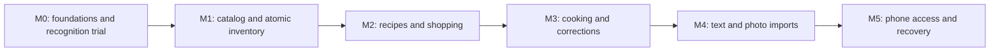

# Architecture execution plan

Status: finalized for implementation on October 7, 2026.

[../architecture.md](../architecture.md) is the authoritative architecture. This folder defines how to build and release it. Architecture choices are settled. Installed versions, HTTPS address, phone choice, backup location, and measured results are recorded in this folder; secrets remain in ignored local files.

Implementation is underway. See [06-implementation-status.md](06-implementation-status.md) for current evidence. Remaining recognition and release requirements are still pending.

## Documents

| Document | Purpose |
| --- | --- |
| [01-review.md](01-review.md) | Review history and disposition of the findings incorporated into the final design. |
| [02-target-architecture.md](02-target-architecture.md) | Architecture entry point and decision ownership. |
| [03-execution-plan.md](03-execution-plan.md) | Ordered work packages, dependencies, deliverables, and completion criteria. |
| [04-acceptance-plan.md](04-acceptance-plan.md) | Required behavior checks, recognition gate, and release walkthrough. |
| [07-recognition-report.md](07-recognition-report.md) | Real-photo trial, pinned local model identity, measured latency, and remaining quality gate. |
| [05-operations.md](05-operations.md) | Settled Windows startup, HTTPS phone access, backup/restore, and future cloud path. |
| [12-human-benchmark.md](12-human-benchmark.md) | Paired human timing protocol, private worksheets, confirmation evidence, and scoring. |
| [11-offline-evidence.md](11-offline-evidence.md) | Enforced offline fridge trial, connectivity controls, rule cleanup, and normal-user worker restart. |
| [10-release-checklist.md](10-release-checklist.md) | Final deployment selections and the remaining execution sequence, owners, and release evidence. |

## Implementation order

M0's application scaffold gates M1. Its recognition measurements may continue during M1-M3 but must pass before completing M4. Photo input is required for the complete first version.

## Milestone status

| Milestone | Status | Required evidence |
| --- | --- | --- |
| M0 | In progress | Runnable scaffold, pinned dependencies, account setup, recognition report. |
| M1 | Core acceptance complete | Pantry/editor/history slice and atomic confirmation checks. |
| M2 | Core acceptance complete | Recipes, persistent shortlist, and maximum-target shopping examples. |
| M3 | Core acceptance complete | Cooking snapshots, reviewed corrections, and reversal checks. |
| M4 | In progress | All input types, bounded jobs, recovery checks, and passing recognition gate. |
| M5 | In progress | Backup/export restores and Windows HTTPS startup/scheduling implemented; router reservation and actual-device walkthrough remain. |

Continue from [remaining execution checklist](10-release-checklist.md) and [implementation status](06-implementation-status.md). Record results and update this status table as implementation proceeds. Design changes must update the canonical architecture and affected milestone/acceptance/runbook together.

Remote hosting, household sharing, and meal planning are later work. Recognition service charges are fixed at $0.

## Executed recovery and phone setup

- [Recovery commands and evidence](08-recovery-evidence.md)
- [Windows startup and iPhone setup](09-iphone-and-startup.md)

The backup mirror was selected on the separate C: disk. The actual phone is an iPhone; router reservation, phone root trust, and its walkthrough remain explicit execution checks.
