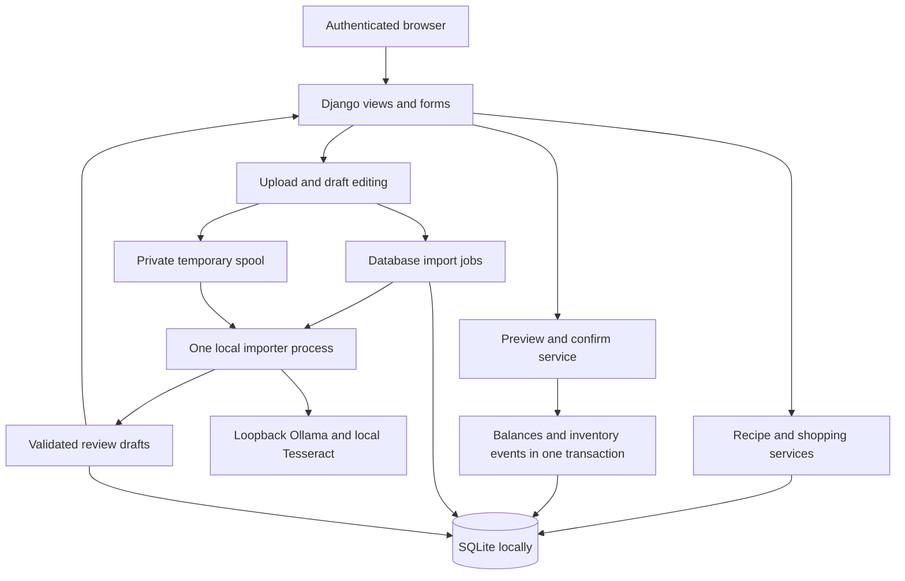

# Kitcher architecture

Status: finalized for implementation on October 7, 2026; deployment decisions and execution evidence updated October 9, 2026.

This document is the authoritative first-version architecture. The [execution plan](architecture-execution/03-execution-plan.md), [acceptance plan](architecture-execution/04-acceptance-plan.md), and [operations runbook](architecture-execution/05-operations.md) implement these decisions. The design is finalized; implementation is underway. See [implementation status](architecture-execution/06-implementation-status.md) for current evidence.

## Product scope

Kitcher is a personal pantry and grocery-planning application. The first version tracks approximate quantities, maintains an editable recipe book, suggests three favorites by default, supports recipe swaps and serving changes, and recommends purchases sufficient to cook any one selected recipe.

Inventory updates support explicit manual forms, text, fridge photos, receipt photos, and recorded cooking. Every update shows the interpreted operation and resulting balance before confirmation. The selected recipes are alternatives; cooking one recomputes readiness for the same saved shortlist.

Run the application and recognition on the existing Windows computer. Phone access uses the home network while the computer is running. Hosting and recognition require no paid service, and there is no paid inference fallback. The computer's electricity, storage, and hardware remain local operating resources.

Public signup, household sharing, weekly meal planning, external recipe recommendations, substitutions, optional recipe ingredients, expiration tracking, multiple storage locations, ingredient-specific density conversions, and cloud hosting are outside the first version.

## Final decisions

| Area | Decision |
| --- | --- |
| Application | Python 3.12; Django 5.2 LTS; one domain app; templates and small JavaScript enhancements. |
| Dependencies | Pin exact supported patch versions and transitive dependencies in M0. The review baseline is Django 5.2.18; apply newer security patches before pinning if available. |
| Database | Local SQLite; integer thousandths; IMMEDIATE transactions; 5-second busy timeout; no whole-request transactions. |
| Account | One pre-created account; session authentication; all domain access scoped to its owner. |
| Inventory | One atomic preview/confirmation service, immutable events, owner pantry revision, draft revision, and UUID idempotency. |
| Shopping | Three favorites by default; aggregate within each recipe; take maximum requirements across selected alternatives. |
| Local web server | Waitress on 127.0.0.1:8001; Caddy provides HTTPS and static serving for phone access. |
| Phone TLS | Caddy internal CA with its public root certificate trusted on the phone; fixed private address assigned by a router DHCP reservation. |
| Recognition | Ollama local-only, baseline gemma3:4b, plus Tesseract English OCR; one database-backed local importer process. |
| Uploads | One JPEG/PNG per job; 10 MiB encoded limit; 25,000,000 decoded pixels; private spool. |
| Processing | 120-second total execution timeout; 300-second claim lease; 3 total transient-failure attempts with 10/30-second delays. |
| Source lifecycle | Source becomes unusable after 24 hours; immediate deletion on apply/cancel; cleanup every 15 minutes while running and on startup. |
| Recovery | SQLite backup API; seven daily backups retained; pre-migration backups retained separately; versioned JSON domain export. |
| Application tests | Django's built-in test runner, including unittest-compatible pure calculation tests. |
| Release | M0-M5 acceptance gates, representative recognition benchmark, actual-phone walkthrough, and demonstrated restore. |

The deployed address is 192.168.1.100, the phone is an iPhone, and the verified backup mirror is C:\Users\<Windows-user>\KitcherBackups on a separate physical disk. DHCP reservation completion and actual-phone trust remain execution checks; see the [remaining execution checklist](architecture-execution/10-release-checklist.md). Exact dependency patches, generated secrets, and model digest are deployment artifacts recorded during M0/M5. They are not unresolved architecture choices. Model quality and speed are implementation checks, not claims of measured performance.

[Django supported releases](https://www.djangoproject.com/download/), [Waitress Windows support](https://docs.pylonsproject.org/projects/waitress/en/latest/), and [Caddy internal TLS](https://caddyserver.com/docs/caddyfile/directives/tls).

## Runtime and module boundaries

Use Python 3.12, a patched Django 5.2 LTS release, server-rendered templates, and SQLite locally. PostgreSQL is the future cloud database. Use plain forms and small JavaScript enhancements for upload progress, status polling, and review interactions.

Keep one Django domain app with service modules. The local importer is a separate process running the same codebase and database. Introduce neither Redis nor a separate public API for the initial version.

```text
manage.py
kitcher/
  settings.py                # Environment-driven settings; local/database profiles
  urls.py
  wsgi.py
pantry/
  models.py
  forms.py
  views.py                   # Authentication, owner scoping, forms, response rendering
  services/
    quantities.py            # Units, Decimal calculations, fixed-point boundaries
    inventory.py             # Preview and sole balance mutation entry point
    recipes.py               # Recipe validation, revision changes, snapshots
    suggestions.py           # Ranking and explicit shortlist updates
    shopping.py              # Scaled per-recipe requirements and maximum targets
    imports.py               # Draft editing, private uploads, confirmation adapter
    import_worker.py         # Claims, publication, retries, expiry, cleanup
    candidates.py            # Explicit text patterns and candidate validation
  interpretation/
    runner.py                # Bounded child: English OCR and loopback vision
  management/commands/
    process_imports.py
    cleanup_imports.py
    backup_pantry.py
    export_pantry.py
    import_pantry.py
  migrations/
  templates/pantry/
  static/pantry/
tests/
var/                         # Ignored local database and private import spool
```

The files above are implementation targets. Core inventory, recipes, shopping, cooking, and the import pipeline are implemented. Recognition acceptance and actual desktop/iPhone walkthroughs remain open. Recovery, Windows startup/scheduling, and local Caddy HTTPS are implemented; evidence is in the execution folder. Views, admin forms, workers, and management commands call the same domain services rather than updating balances independently. Validated recovery into an empty account is the explicit exception: it inserts historical records and balances atomically, preserving archival snapshots and mapping export references. It refuses existing domain data; ordinary new changes continue through signed preview/confirmation. Recipe admin edits and ingredient-line edits also advance the recipe revision through its service.



## Records and constraints

Use Django's built-in user and session authentication with one pre-created account and public signup disabled. Every domain record is owned directly or through an owner-scoped parent. Reject cross-owner references on all service calls, including admin and worker calls.

| Record | Contract |
| --- | --- |
| Ingredient | Owner, name, normalized name, dimension, canonical unit; unique owner/name key. Treat canonical dimension as immutable after use. |
| IngredientAlias | Owner, normalized alias, ingredient; unique owner/alias. Trim and Unicode-normalize/casefold in Python consistently. |
| PackageSize | Owner, ingredient, label, positive amount in canonical thousandths. A package is a conversion aid; it is not an inventory location. |
| PantryState | Unique owner, revision integer. Every confirmed inventory mutation advances it once. |
| PantryItem | Unique owner/ingredient, nullable quantity in thousandths, item version, last-confirmed time. Known quantities must be nonnegative. |
| Recipe | Owner, title, favorite, positive default servings, instructions, revision; incomplete recipes may be saved but cannot be suggested or cooked. |
| RecipeIngredient | Recipe, ingredient, positive canonical quantity when resolved, nullable amount with original input/reason while unresolved, and display order. Repeated ingredient lines are allowed and aggregated during calculations. |
| RecipeSelection | One per owner, revision. Membership and desired servings are changed by explicit user actions. |
| SelectionEntry | Selection, recipe, positive desired servings, position; unique recipe and position within selection. |
| InventoryEvent | Owner, request UUID, canonical command hash, source, time, pantry revisions, optional recipe snapshot and reversal link. Unique owner/request UUID. At most one reversal per original event. |
| InventoryEventLine | Event, ingredient, operation/input amount, optional reconciliation basis, before/after nullable quantities, versions, and effective delta when both balances are known. One consolidated line per ingredient. |
| ImportDraft | Owner, type, schema version, revision, editable proposed operations, unresolved fields, status, optional job/fingerprint, applied event. |
| ImportJob | Owner, draft, state, private source reference, fingerprint, attempt count/token, lease expiry, error category, model/prompt version, timestamps. |

Every recipe ingredient is required. A known package size converts phrases such as half a bag: half of a 1000 g bag is 500 g. Without a matching package amount, the quantity remains unresolved.

Use relational fields for stable entities and constraints. JSON is suitable for immutable recipe snapshots, interpretation candidates, and unresolved-field explanations, but does not replace service validation.

Protect referenced ingredients from deletion; archive used recipes instead of removing their history references. Snapshots keep titles, units, conversions, servings, and actual consumption readable after catalog or recipe edits.

## Quantity semantics

- Store quantities as nullable `BigIntegerField` values: 1000 stored units = 1 gram, milliliter, or item. Keep the dimension on the ingredient.
- Use `Decimal` created from strings for input, conversion, and scaling. Never use binary floats for domain arithmetic.
- Quantities are limited to 1,000,000,000,000 canonical units (1,000,000,000,000,000 stored thousandths). Serving counts range from 0.001 to 1000 in increments of 0.001. Reject computed requirements exceeding the quantity bound. Use Decimal precision 28.
- Input and actual-usage amounts round to 0.001 canonical units with `ROUND_HALF_UP`; show the normalized value before confirmation. Reject positive inputs that become zero and values outside documented field bounds.
- Scaled recipe requirements round upward to the same precision once, after aggregating an ingredient's lines within the recipe. This avoids advising slightly less than the modeled requirement.
- Preserve fractional counts for actual usage. For grocery advice, show the exact shortfall and round count purchases upward to whole items; do not round mass or volume into unknown package sizes.
- Null quantity means unverified, zero means confirmed absent, and a missing pantry row means unverified. Creating an ingredient does not assert that its balance is zero.
- Add/subtract requires a known starting balance. For unknown stock, review must first supply a current amount, or explicitly confirm that the previous balance was zero. Log this reconciliation with the operation.
- Units convert only within a dimension initially. A recipe requiring an incompatible unit stays incomplete until its quantity is corrected into the ingredient's canonical dimension. Ingredient-specific density conversions are an optional later extension.
- Unknown stock shows a verification action, not a definite buy amount or readiness label.

Integer storage avoids SQLite's documented decimal limitations. [Django decimal handling](https://docs.djangoproject.com/en/5.2/ref/databases/#decimal-handling)

## Recipe and shopping contract

For each recipe, aggregate ingredient lines, multiply by desired/default servings, and normalize to canonical precision. For each selected ingredient, target the maximum requirement across these recipe totals, then subtract known stock and clamp at zero.

Ranking uses the draft's deterministic order: ready first, fewer shortages or unverified ingredients next, higher mean confirmed coverage next, then stable recipe ID. Unknown stock has zero confirmed coverage for ranking only. Recipes without a complete set of valid requirements are excluded.

Shopping checkboxes are interface-only indicators and reset when the shopping result is refreshed. They do not reserve stock or persist purchases.

An empty shortlist has an empty shopping result. Fewer than three favorites yields fewer suggestions. Swaps exclude already selected recipes. Positive fractional serving counts are allowed, with a documented input precision.

Recipe edits preserve shortlist membership, but recompute requirements from the new revision and mark the change in the interface. A cooking preview captures the recipe revision and pantry revision; confirmation rejects either being stale.

## Atomic inventory confirmation

The UI sends operations, expected pantry revision, draft ID/revision when applicable, recipe ID/revision when cooking, and a stable request UUID. The canonical command hash covers the normalized operations and these expected revisions, scoped to the owner by the event uniqueness constraint. Preview tokens are stored server-side or signed; a hidden browser field is not trusted as the source of the expected calculation.

1. Validate ownership, operation types, finite quantities, units, recipe snapshot, and resolved fields. Group operations by ingredient and show their resulting balances.
2. Begin a short explicit database transaction. For SQLite, use `IMMEDIATE` transaction mode with a 5-second busy timeout; leave `ATOMIC_REQUESTS` disabled.
3. Check owner/request UUID first. If it already succeeded with the identical command hash, return that event. Reject UUID reuse with a different command.
4. Claim the current pantry revision by conditional update: update only where owner and revision match the preview; increment exactly once. Zero affected rows means stale preview.
5. For an import, conditionally claim the reviewed draft revision/status as well. Validate the current recipe revision inside the transaction if cooking. On PostgreSQL, lock the recipe row; recipe edits use the same row/transaction boundary so an edit cannot pass between this check and commit.
6. Read affected balances, confirm the expected item versions, calculate final states, and reject negative or unresolved results. Apply all balances and versions.
7. Insert the event and immutable lines, link the draft to the event, and complete the draft status. Commit everything together.
8. On any mismatch or failure, roll back everything. Return a fresh preview requiring another confirmation. A revised command receives a new request UUID.

On simultaneous identical requests, a uniqueness collision or lock timeout must resolve by looking up the committed event in a new transaction, or return a safe retry response using the same UUID. Never continue inside a transaction broken by an integrity error. A lost HTTP response does not mean the event failed.

The per-owner revision intentionally invalidates previews after any inventory update. This is slightly conservative and handles missing rows without a complex per-ingredient locking scheme. All writers follow the same contract. On PostgreSQL, conditional updates still apply; row locks may assist but do not replace revision checks. [Django SQLite transaction and locking behavior](https://docs.djangoproject.com/en/5.2/ref/databases/#transactions-behavior)

## Corrections and undo

Events are immutable. A new reversal event references the original; a second reversal of that original is blocked.

When both old and new quantities were known, preview the inverse effective delta against today's balance. For example, purchase +6, then use 2: reversing the purchase subtracts 6 from the current balance, subject to nonnegative validation. An absolute correction from 4 to 6 also has an effective delta of +2; show that context before reversing it.

If the original changed knowledge state, or its inverse cannot be applied safely, require explicit reconciliation. Do not fabricate a delta for unknown stock or silently restore an old balance. If the user chooses a different current balance, record a linked correction rather than calling it an exact reversal.

## Import lifecycle

Job states: `queued -> processing -> succeeded | failed`, with terminal `cancelled` and `expired` states. Retryable errors return to queued only while the source is usable and attempts remain. An expired lease permits another attempt with a new token. Use a 300-second lease, a 120-second total processing timeout, and three total attempts with 10/30-second retry delays. Inference/OCR must be stopped or abandoned at the timeout; late results are rejected.

Draft states: `processing -> needs_review -> applied`, with terminal `cancelled` and `expired` states. A failed job moves its draft to needs_review with an unresolved processing error; the user may enter candidates manually or explicitly retry. Retrying changes it to processing and increments its revision. A draft is confirmable only in needs_review with resolved, nonempty operations. Source expiry marks unfinished processing as expired, but a successfully interpreted needs_review draft stays editable after its source is deleted.

Uploads are authenticated and limited to one image per job, 10 MiB encoded bytes, and 25,000,000 decoded pixels. Support JPEG and PNG; detect unsupported phone formats and explain how to use a compatible image. Validate by decoding, normalize image orientation, generate a private random filename, and keep it outside publicly served static/media directories.

Persist the upload and job before returning its status URL. Filesystem and database writes are not one transaction: remove files on job-creation failure and periodically clean unreferenced files.

The worker claims one job in a brief transaction, releases the transaction, then runs OCR/inference with timeouts. Commit a result only if its attempt token and lease still match. An OS-held lock permits only one importer process for the data directory. User edits increment draft revision; a manual edit during processing cancels that attempt. A worker result may never overwrite an edited, cancelled, expired, or applied draft.

Use JSON-schema structured output where supported, then validate candidate fields in Python. Treat all recognized content as proposed ingredient data. Unreadable or ambiguous values remain unresolved. [Ollama structured outputs](https://docs.ollama.com/capabilities/structured-outputs)

Fridge candidates propose SET operations only for visible items. Every recognized quantity needs explicit user review. Quantities must come from visible food counts or readable labels on apparently unopened packages; a label on an opened container does not establish its remaining amount; do not invent container weights or treat hidden ingredients as absent. Receipt candidates propose ADD operations after package amounts are resolved. Text supports explicit bought/used/have-left patterns first; ambiguous prose requires review.

Compute a SHA-256 fingerprint of the original bytes to warn about possible duplicate uploads for the same owner. A fingerprint is not the idempotency key: legitimate similar purchases may be allowed after an explicit duplicate warning, while one draft can produce only one applied event.

Source images expire 24 hours after upload, including queued jobs; show that time in the UI and deny processing/access after expiry. Attempt deletion immediately after apply/cancel. Access is denied even if a Windows file lock delays physical deletion; cleanup retries and records that failure. Run cleanup every 15 minutes while the app runs and before worker startup. Physical deletion while the computer is off is impossible; remove overdue files on the next startup. Structured review data survives deletion, but reprocessing requires re-upload. Expire queued/processing work whose source has expired; a completed review draft remains reviewable.

Configure Kitcher's dedicated Ollama runtime on 127.0.0.1:11435 with local-only mode and a fixed model. Port 11434 is occupied by an existing WSL model service on this machine; the dedicated port avoids changing that service. Restart it after changing `OLLAMA_NO_CLOUD=1`. There is no hosted inference fallback. [Ollama FAQ](https://docs.ollama.com/faq#how-do-i-disable-ollama-cloud-features)

## Recognition acceptance and release

Use gemma3:4b Q4_K_M as the implementation baseline, pinned to an explicit local backend manifest and verified against the actually loaded digest, with Ollama restricted to the downloaded local model at 127.0.0.1:11435 and cloud features disabled. Run Tesseract with English OCR, then catalog/package parsing; use local vision interpretation only to produce candidates and unresolved fields.

M0 records results from ten fridge and ten receipt photos. Release requires valid or explicitly unresolved candidate output for every sample, no automatic inventory writes, and at least 18 of 20 samples reaching review within 60 seconds. Median human review/correction/confirmation time must be no greater than median manual entry/confirmation time for the same visible observations across the corpus. If the baseline fails, tune local preprocessing/prompting or replace the local model using the same corpus and record the evidence; photo acceptance remains incomplete until the gate passes. Never remove photo input or add a paid fallback to bypass the gate.

The shortlist default is three. Usability changes after release are ordinary future design changes.

## Delivery and future extension

Implement M0 foundations/recognition trial, M1 atomic inventory/history, M2 recipes/shopping, M3 cooking/corrections, M4 reviewed text/photo imports, then M5 phone access/recovery. Complete each milestone's acceptance criteria before marking it done. The [execution plan](architecture-execution/03-execution-plan.md) defines the work packages.

Remote access is a later extension: PostgreSQL, private expiring object storage, and authenticated outbound worker jobs. Cloud localhost never refers to the user's computer. Select vendors and check their prices/limits when that extension is requested.

The earlier hardware observation was approximately 32 GB RAM, Ryzen 9 3950X, and RTX 2070 SUPER with 8 GB GPU memory; M0 verifies the current machine and measures behavior. No hardware, model performance, installation, or application checks are claimed complete by this architecture finalization.