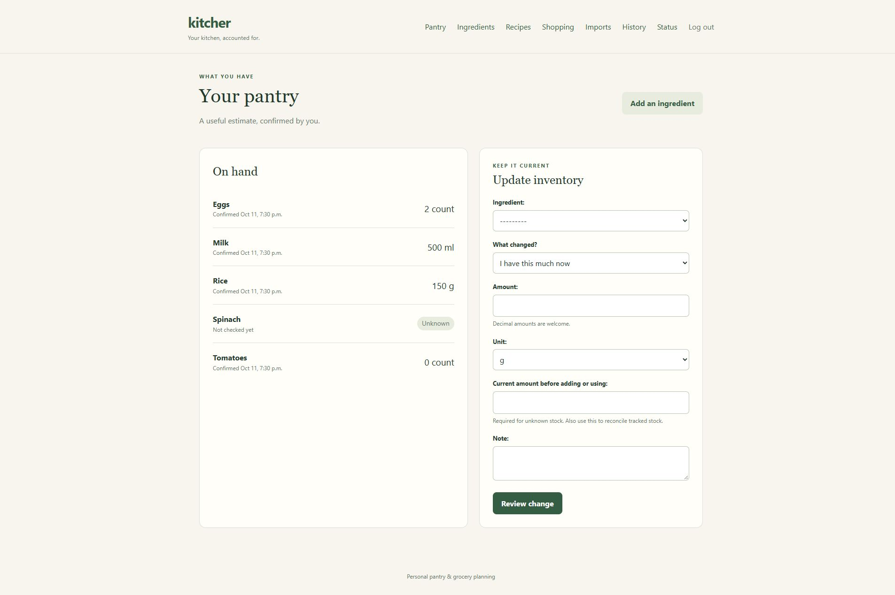
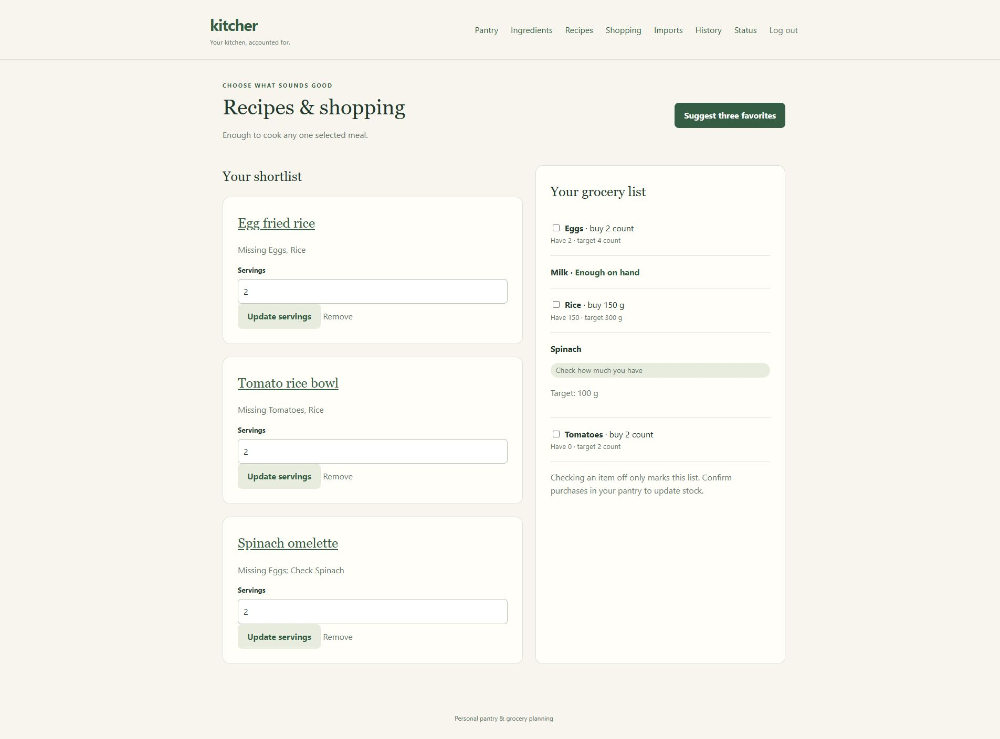
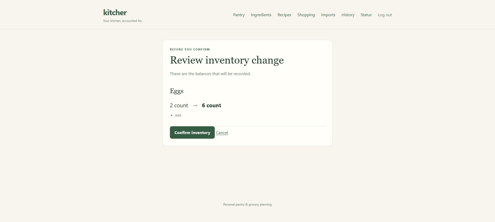
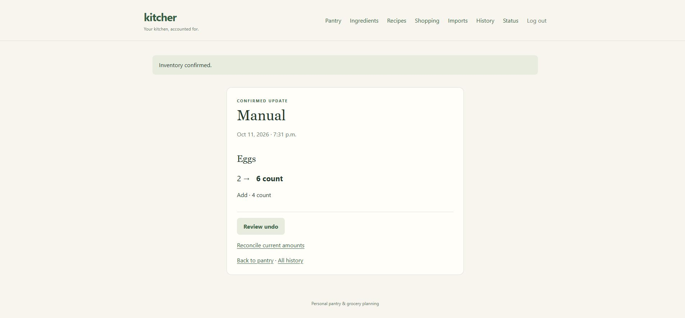

# Kitcher demo

Kitcher is a local Windows application used through a browser. This screenshot walkthrough shows the actual Django interface running with fictional food and recipes in a separate demonstration database. The application is not hosted publicly. Follow the [installation instructions](../README.md#run-locally-on-windows) to run your own copy.

## 1. See what is on hand

The pantry distinguishes an unknown amount of spinach from zero tomatoes. Eggs, rice, and milk have confirmed amounts.

## 2. Choose recipes and see what to buy

Three favorite recipes share a grocery list. Eggs need a target of four, rather than adding every recipe's requirements together. Unknown spinach needs checking before a purchase amount can be calculated.

## 3. Review a purchase

Adding four eggs previews a change from two to six. Inventory remains unchanged until confirmation.

## 4. Confirm and retain history

Confirmation records the purchase once. The event retains the before/after balances and offers reviewed undo or reconciliation.

## Current limits

Manual pantry, recipe, shopping, cooking, history, and recovery workflows are implemented. Local photo recognition creates editable proposals and still makes semantic errors. The complete receipt/photo corpus, human review timing comparison, and actual iPhone walkthrough remain outstanding. This demo does not establish those acceptance criteria. See the [implementation status](architecture-execution/06-implementation-status.md) and [release checklist](architecture-execution/10-release-checklist.md).
